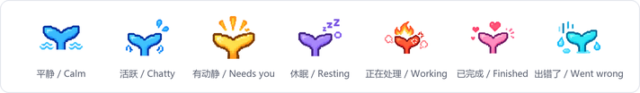

# 工作区侧栏（emoji-workspace-sidebar）

一个 DeepSeek Harness（以下简称 DSH）插件包。它把右侧栏文件树和左侧工作区列表的使用流程整理到一起，包含五项能力：切换对话时自动显示该对话工作区的文件目录、记住拖动后的右侧栏宽度、把文件树里的文件或文件夹拖进输入框变成 `@` 引用、按最近对话时间排列左侧工作区并支持手动置顶，以及在对话行显示状态表情并支持手动标记。

五项能力共用一次启用、一份样式表和同一块设置区域。插件只包含一个包，不需要额外下载其他插件。

## 目录

- [功能概览](#功能概览)
- [安装](#安装)
- [功能说明](#功能说明)
- [设置项](#设置项)
- [本地存储](#本地存储)
- [兼容性与依赖](#兼容性与依赖)
- [已知限制](#已知限制)
- [开发与验证](#开发与验证)
- [许可证](#许可证)

## 功能概览

| 能力 | 触发方式 | 是否需要设置 |
| --- | --- | --- |
| 自动显示工作区文件 | 切换到某个对话 | 可在「设置 → 通用」关闭 |
| 记住右侧栏宽度 | 拖动中栏与右栏之间的分隔条 | 默认启用，可在设置中恢复默认宽度 |
| 拖拽文件变成 `@` 引用 | 从右侧栏文件树拖到输入框 | 无需设置 |
| 工作区按最近对话排序 | 对话更新时间变化后自动执行 | 无需设置 |
| 手动置顶工作区 | 工作区行右侧「…」菜单 →「置顶工作区」 | 无需设置 |
| 对话行状态表情 | 对话状态变化时自动更新 | 可在「设置 → 通用」关闭 |

## 安装

插件是一个标准的 DSH 插件包，`package.json` 中的 `dsh.bundle.patch` 声明了装载补丁，`dsh.client` 声明了浏览器侧模块。安装方式有三种，任选一种即可。

### 一、从 npm 安装（推荐）

```bash
dsh plugin install emoji-workspace-sidebar
```

或直接使用包管理器：

```bash
pnpm add emoji-workspace-sidebar
```

npm 包与 GitHub 仓库同步发布，包名即安装标识，不需要额外配置。

### 二、从 GitHub 安装

在 DSH 的「插件」页面点击「添加插件」，在「包名或地址」中输入仓库地址：

```
https://github.com/yeloooooooooo/dsh-workspace-sidebar
```

也可以填写 pnpm 支持的简写形式 `github:yeloooooooooo/dsh-workspace-sidebar`。需要指定版本时在末尾加上标签，例如 `github:yeloooooooooo/dsh-workspace-sidebar#v1.3.0`。此方式要求本机能访问 GitHub 并且已安装 Git；注意 npm 默认会改用 SSH 协议，若本机未配置 GitHub 的 SSH 密钥，请改用 pnpm，它走 HTTPS。

### 三、从 Release 附件安装

在 [Releases](https://github.com/yeloooooooooo/dsh-workspace-sidebar/releases) 页面下载对应版本的 zip，解压后用本地目录方式安装（见下文）。

### 四、从本地目录安装

把仓库克隆或下载到本机任意位置，在「添加插件」中填写该目录的绝对路径，例如：

```
D:\插件\dsh-workspace-sidebar
```

路径必须是绝对路径，相对路径会被拒绝。

### 五、命令行安装

已配置 `dsh` 命令行时，可以执行：

```bash
dsh plugin install https://github.com/yeloooooooooo/dsh-workspace-sidebar
```

以上方式都会把插件写入当前 profile 的依赖，并加入 `dsh.profile.bundles`。安装完成后建议重启 DSH，以确保浏览器侧模块加载的是新版本。

### 验证安装

打开任意一个已有工作目录的对话。如果右侧栏处于收起状态，它应当自动展开并停在「文件」页，地址栏显示该对话所属工作区的绝对路径。若右侧栏原本就展开、且停在别的页面（终端、浏览器、会话诊断等），插件不会接管它，此时切换到另一个尚未处理过的对话再观察一次。

## 功能说明

### 一、对话打开时自动显示工作区文件

点击或切换到一个对话时，插件把这个对话所在工作区的文件目录显示在右侧栏，形成类似代码编辑器资源管理器的体验。文件树本身来自随 DSH 附带的 `files` 页（`@deepseek-ai/dsh-client-ui-sidebar-files`）；如果其他插件接管了这个页类型，自动打开的就是接管后的实现。本插件只决定何时打开。

自动打开需要同时满足以下条件。任一条件不满足时，插件保持静默，不报错，也不改变界面。

| 条件 | 说明 |
| --- | --- |
| 该对话已切到前台 | 由会话切换驱动 |
| 该对话的工作目录已知 | 新建会话在第一条消息之后才满足 |
| 窗口宽度不小于 768 像素 | 窄窗口下右侧栏为全屏呈现，自动打开会盖住整个对话 |
| 本次页面打开期间该对话尚未被处理 | 每个对话只自动打开一次 |
| 右侧栏没有停在别的页面上 | 已经在阅读编辑器、Git、侧边对话等页面时不替换 |
| 「设置 → 通用」中的开关处于开启状态 | 见[设置项](#设置项) |

具体行为如下。

- 每个对话打开一次。第一次把某个对话切到前台、且它的工作目录已知时，右侧栏会打开 `files` 页并展开。
- 尊重手动关闭。本次打开页面期间，收起右侧栏或关掉该页之后，回到同一个对话不会再自动弹出。刷新页面后重新计算。
- 不替换正在阅读的页面。右侧栏已经展开并停在别的页面时，插件不会替换它，该对话因此被视为已处理。
- 窄窗口不强行打开。窗口宽度小于 768 像素时右侧栏为全屏呈现，自动打开会盖住整个对话，因此此时不打开。把窗口拉宽后，仍处于尚未处理状态的对话会补上。
- 没有工作目录的对话不动作。新建会话在第一条消息之后才有工作目录，届时自动补开。
- 开关位于「设置 → 通用 → 对话打开时显示工作区文件」。关闭后不再自动展开；重新打开会清空已处理记录，当场重新计算一次。关闭开关不会收起已经打开的目录。

### 二、记住右侧栏宽度

DSH 框架把右栏宽度保存在运行期的布局 store（`layoutInfo.rightbar`）中，不做持久化，首次打开时按视口宽度的 45% 计算，因此每次刷新都会回到一个偏宽的位置。插件不修改框架代码，只做两件事：取得框架正在使用的布局 store 并写回记住的宽度；监听它，把拖动后停稳的宽度存入浏览器本地。

- 首次使用（尚未拖动过）：右栏按约 26% 视口宽度打开，限制在 300–440 像素区间内。1440 像素宽的窗口下即 374 像素。
- 拖动之后：松手约 0.4 秒后保存，拖动过程中的连续写值不会被逐次保存；下次启动恢复同一宽度。
- 窗口变小时受框架自身上限约束，最多 70% 视口、最少 300 像素，不会撑破布局。
- 设置项位于「设置 → 通用 → 右侧栏宽度」，显示已记住的宽度，并提供「恢复默认宽度」按钮。重置后回到首次使用的默认宽度，而不是框架的 45%。
- 存储键为 `dsh.rightbar-width-memory.v1`。该键沿用旧名，因此已有安装的宽度记录无需迁移。

布局 store 通过 `root` 槽位上框架自己的 store handle 取得，其 `create()` 返回框架渲染所用的同一实例，写入立即生效，不会产生第二个 store。若其他插件替换了整个 `root` 框架，插件找不到布局 store 时会静默跳过。

### 三、把文件树里的文件拖进对话

在右侧栏文件树中按住某一行拖到对话输入框并松手，该文件或文件夹会作为 `@` 引用插入草稿，效果与在 `@` 菜单中选择相同：输入框显示紧凑的引用块，发送时模型收到工作区相对路径。

操作步骤：

1. 在文件树中按住某一行（文件或文件夹）不放，开始拖动。
2. 拖到输入框上方，输入框出现描边，表示可以放下。
3. 松手，引用追加到草稿末尾；若草稿已有文字，会先补一个空格。

拖动时跟随一个小标签，显示将要插入的 `@路径`。

文件行只要带有绝对路径即可拖动，因此以下实现都受支持：官方文件页（每行带 `data-files-path`），以及接管该页的第三方资源管理器（行以 `title` 携带绝对路径）。两者都不自带行可拖动，插件在按下鼠标时临时把该行设为 `draggable`，松手或拖动结束后还原，不修改这两者的代码。

从系统拖入的真实文件仍走输入框自带的附件上传，互不干扰，因为插件只认自己私有的拖拽类型 `application/x-dsh-workspace-sidebar-file`。树内部原有的拖放也不受影响。

限制：只插入 `@` 引用，不复制文件内容；松手时按开始拖动时所在的会话插入，拖动过程中切换会话不会改变目标；含空格的路径按引用语法写成 `@"路径"`；文件夹引用保留结尾斜杠，写作 `@目录/`。

### 四、工作区按最近对话排序与手动置顶

左侧栏按工作区分组显示对话，而工作区之间的先后顺序来自 Host 注册表本身的顺序：一个新的对话不会让所属工作区自动浮上来，需要向下翻找。插件按最近对话时间调整这个顺序，并支持手动置顶。

- 规则：每个工作区取其中最近更新的一条对话作为时间戳，最近有对话的排在最前面，其余依次排列。没有已知对话的工作区排在最后，并保持它们之间的相对次序；时间相同的也保持原次序，不会无谓重排。
- 手动置顶：把鼠标移到工作区行上，点击行右侧的「…」按钮打开操作菜单，选择「置顶工作区」，该工作区会固定排在最前，不受对话时间影响。再次打开同一菜单选择「取消置顶」即可恢复。置顶项按置顶的先后排列，最近置顶的排在更前面。置顶记录保存在浏览器本地，只影响当前设备。工作区被删除后，其置顶记录会被自动清除。
- 写入方式：通过 `workspaces.insertBefore()` 改写 Host 的工作区顺序，效果等同于手动把工作区拖到该位置，因此重启、切换设备后依然保留。它不改变组内对话的排序。
- 触发时机：监听工作区快照与对话列表快照，取其中最后的变化时间，稳定 1.5 秒后再调整。对话进行中每一步都会推进更新时间，等它停稳只写一次，避免频繁改写注册表。
- 失败处理：Host 拒绝某次移动时只记录错误，且同一目标顺序不会在每个快照上反复重试；顺序一旦变化会重新计算。

注意：这是真实的顺序变更，不是临时的界面效果。如果手动把某个工作区拖到某处，插件下一次检测到对话时间变化时仍会按时间重新排列；希望它固定不动时，请使用「置顶工作区」。

### 五、对话行状态表情

左侧栏每个对话行右侧原本显示一个状态圆点。插件在时间标签之后增加一个 20×20 的鲸鱼尾像素表情，用来一眼看出这条对话处于什么状态。

| 表情 | 触发状态 | 含义 |
| --- | --- | --- |
| 有动静 | 有待处理的审批、计划确认或提问 | 上方放射线条 |
| 正在处理 | 对话正在运行 | 双叉燃起火苗 |
| 已完成 | 对话结束但尚未查看 | 周围飘着爱心 |
| 平静 / 活跃 / 休眠 / 出错了 | 不自动触发 | 仅作为手动标记可选 |

<p align="center">
  
</p>

**不活跃的对话不显示任何表情。** 只有当对话正在运行、正在等你操作、或刚结束还没查看时才会出现表情；其余状态的行保持原样，不占位置也不留空框。

**手动标记。** 在对话行右侧「…」菜单中打开「标记表情」，可以把七种表情中的任意一种挂到该对话上作为书签。标记优先于自动状态：设了标记的对话无论运行还是空闲都显示所标记的表情；选择「清除标记」后恢复为按状态自动显示。标记保存在浏览器本地（`dsh.session-row-marks.v1`），对话被删除后其标记会被自动清除。

- **表情来自裁剪的像素图。** 七张图由本插件附带的鲸鱼尾精灵图逐格裁切而成，保留原始像素边缘（`image-rendering: pixelated`）。以 data URL 内联进客户端模块：这个构建没有供客户端包引用的资源路由，而一次网络往返换七张小图的代价高于内联。
- **不会两个提示并排**：表情挂在行尾的非交互图标位；鼠标悬停到某一行时该区域按宿主既有行为隐藏，此时只保留官方状态点。
- **只在有意义时变化**：运行中的对话在「正在处理」与「有动静」之间缓慢交替（约 2.2 秒一帧），其余状态各固定一张。
- **可关闭**：「设置 → 通用 → 对话状态表情」开关关闭后，行尾不再渲染任何内容，恢复官方状态点的原始观感。

## 设置项

三个设置项都位于「设置 → 通用」页面中段。

| 设置项 | 类型 | 说明 |
| --- | --- | --- |
| 对话打开时显示工作区文件 | 开关，默认开启 | 关闭后不再自动展开右侧栏；重新打开会清空已处理记录并当场重新计算一次 |
| 右侧栏宽度 | 只读显示 + 按钮 | 显示已记住的宽度；「恢复默认宽度」按钮回到首次使用的默认宽度 |
| 对话状态表情 | 开关，默认开启 | 关闭后对话行不再显示状态表情，恢复官方状态点 |

工作区排序与置顶没有开关，随插件启用即生效。

## 本地存储

| 项目 | 存储位置 | 键名 | 内容 |
| --- | --- | --- | --- |
| 自动显示开关 | 浏览器 `localStorage` | `dsh.workspace-sidebar.v1` | `{"enabled": true}` 或 `{"enabled": false}` |
| 右侧栏宽度 | 浏览器 `localStorage` | `dsh.rightbar-width-memory.v1` | `{"width": 504}` |
| 工作区置顶 | 浏览器 `localStorage` | `dsh.workspace-order-manual-pins.v1` | 工作区 id 数组，最近置顶的在前 |
| 状态表情开关 | 浏览器 `localStorage` | `dsh.session-row-mood.v1` | `{"enabled": true}` 或 `{"enabled": false}` |
| 对话标记 | 浏览器 `localStorage` | `dsh.session-row-marks.v1` | 对话 id → 表情名，例如 `{"session-id": "fire"}` |

已处理的对话记录只保留在页面内存中，不写入本地存储，刷新页面即清空。

以上数据都只存在于当前浏览器配置文件，不写入 DSH profile，不改动任何配置文件，也不会离开本机。插件没有遥测，不发起任何网络请求。

## 兼容性与依赖

- 依赖随 DSH 附带的右侧栏实现（`@deepseek-ai/dsh-client-ui-sidebar-right`）、框架（`@deepseek-ai/dsh-client-ui-layout`）、输入框（`@deepseek-ai/dsh-client-ui-conversation`）与工作区控制器（`@deepseek-ai/dsh-api-workspace-controller`）。这些包由宿主提供，插件不自行携带，也不引入额外依赖。
- 五项能力彼此独立。某一项的前置服务缺席时，其余各项照常工作：工作区排序在缺少 `workspaces` 服务时静默跳过，宽度记忆找不到布局 store 时静默跳过，状态表情在缺少对话状态源时不挂载。
- 与侧栏实现解耦。只要「文件」页存在，无论由官方文件页还是接管该页类型的插件渲染，自动显示都成立。
- 已在 DSH 0.2.2-rc.3（Windows 桌面端，Chromium 内核）上逐项实测。
- 停用或卸载插件后，五项行为一起消失；已经打开的右侧栏页面保持原样，已经写入的工作区顺序不会回滚。

## 已知限制

- 只在切换对话时触发，不会因为工作区内新增文件而主动刷新文件树。
- 已处理是页面级的临时状态，保存在内存中，刷新页面后所有对话重新计算。若刷新后停在某个对话上，右侧栏可能再次自动展开，这是预期行为。
- 窗口宽度阈值固定为 768 像素，暂不提供配置项。
- 右侧栏宽度的首次使用默认值（约 26% 视口、300–440 像素区间）写死在插件里，不提供设置项。需要其他宽度时请在界面上拖动一次，插件会记住。
- 工作区排序完全由最近对话时间与置顶记录决定，不提供手动拖动后固定的模式。手动拖动得到的顺序会在下一次对话时间变化时被重新排列，希望固定时请使用置顶。
- 若同时启用了会接管整块右侧栏布局的其他插件，自动打开可能被其布局策略覆盖，此时以那个插件的策略为准。
- 拖拽只插入 `@` 引用文本，不注入文件内容，也不改变输入框既有的附件上传行为。

## 开发与验证

插件没有构建步骤。`client.js` 就是浏览器直接加载的产物，改动后刷新页面即可生效；DSH 的客户端模块热更新通道开启时无需刷新。

仓库自带一份离线测试脚手架，用假的右侧栏、假的布局 store、假的 `document`、`React`、Cordis 与假 `localStorage` 启动一次插件，覆盖自动打开、宽度记忆、拖拽引用、置顶排序与状态表情标记：

```bash
node tests/harness.mjs
```

测试脚手架不属于插件包，`package.json` 的 `files` 字段不会把它打包进去。

各项能力的界面行为已在 DSH 0.2.2-rc.3 上实测：打开有工作目录的对话后右侧栏自动展开并停在文件页；700 像素宽窗口下新建会话不会强行打开右侧栏；从 374 像素拖到 504 像素后刷新仍为 504 像素；拖到输入框时出现描边，松手后引用插入草稿；置顶后该工作区移到最前并显示图钉，取消置顶后回到按时间排序的顺序。

## 许可证

MIT。详见 [LICENSE](LICENSE)。
